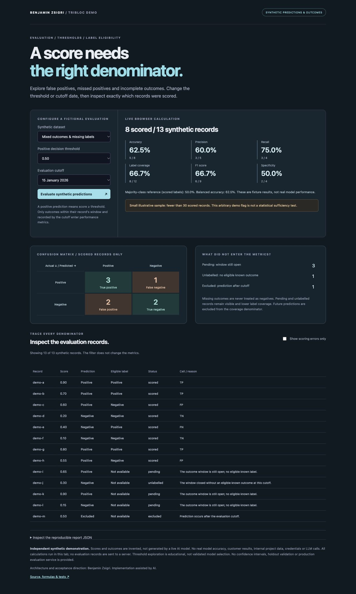

# AI Evaluation Lab

**[Try the live synthetic demo](https://tribloc-ai-evaluation.pages.dev/)** — no installation or local server required.

A browser-only demonstration of binary classification evaluation: threshold trade-offs, explicit metric denominators, incomplete outcome labels and evaluation cutoffs. All scores and outcomes are invented. No model is trained or called, and no real model performance is measured.



## Explore the lab

- **Mixed outcomes:** inspect false positives/negatives alongside pending, unlabelled and future predictions.
- **Imbalanced labels:** a fictional score rule can show 95% accuracy while missing its only positive case. The majority-class reference is also 95%; these are deliberately constructed fixture results, not a performance claim.
- **No known outcomes:** performance values stay undefined rather than showing misleading zero accuracy.
- **Positive-only outcomes:** specificity and balanced accuracy remain undefined when there is no negative class.
- Change the threshold from 0 to 1. A score greater than or equal to the threshold predicts positive.
- Move the cutoff from 15 January to 15 February 2026. A previously unavailable outcome becomes eligible only once recorded, while an outcome outside its allowed window remains unlabelled.
- Filter scoring errors without changing any evaluation denominator. Inspect the full JSON report and input fingerprint.

The mixed fixture at threshold 0.5 and the January cutoff has 3 true positives, 2 false positives, 2 true negatives and 1 false negative. Eight of 13 total records are scored. Coverage is 8/12 because one prediction occurs after the cutoff. Three records are pending and one is unlabelled. The table shows those reasons rather than replacing missing labels with negatives.

## Eligibility rules

These are generic illustrative rules, independently implemented for this sample, not internal project policy.

1. A prediction after the evaluation cutoff is excluded.
2. An outcome can be scored only if it occurs at or after the prediction, within the record's outcome window, and both its observation and recording dates are at or before the cutoff.
3. A record with no eligible known label and an open window is pending.
4. Once the window closes, a record without an eligible known label is unlabelled. An out-of-window outcome does not manufacture a negative label.

Earlier visible rows and metrics do not depend on a future outcome's value. All fixture data is nevertheless public synthetic input; this is not a confidentiality boundary or a real temporal-data access system.

## Metrics and denominators

TP/FP/TN/FN use the positive class. Only scored records enter the confusion matrix and performance metrics.

| Metric | Formula |
| --- | --- |
| Accuracy | (TP + TN) / scored |
| Precision | TP / (TP + FP) |
| Recall | TP / (TP + FN) |
| Specificity | TN / (TN + FP) |
| F1 | 2TP / (2TP + FP + FN) |
| Label coverage | scored / predictions available by cutoff |
| Majority-class reference | max(positive labels, negative labels) / scored |

A zero denominator produces `null`, displayed as **Not defined**. Balanced accuracy is the mean of recall and specificity only when both are defined. The majority-class reference describes class balance among the scored labels; it is not a separately trained or validated baseline. F1 is displayed as a percentage for consistency with the other cards.

The formulas follow standard binary evaluation definitions; see the [scikit-learn classification metric reference](https://scikit-learn.org/stable/modules/model_evaluation.html#classification-metrics). This project implements them directly and does not depend on scikit-learn.

The small-sample flag below 30 scored records is an arbitrary educational reminder, not a statistical sufficiency test. No confidence intervals, holdout validation, calibration study or model-selection guarantee is provided. Adjusting a threshold on these fixtures does not demonstrate generalization.

## Reproducibility and validation

The report includes explicit numerators/denominators, row eligibility reasons, policy version, cutoff, threshold and a canonical SHA-256 input fingerprint. Reordering records does not change the report. The full fingerprint includes all synthetic input records, even outcomes ineligible at that cutoff; only eligible labels influence the performance calculations.

On **2026-10-17**, **39 automated tests** and **10 local browser checks** passed. Tests cover independently specified confusion counts, threshold boundaries, class imbalance, undefined metrics, cutoff/window rules, future labels, invalid inputs, deterministic output and unchanged inputs. The public site is also checked after deployment.

Evidence: [automated test report](docs/test-report.txt), [browser checks](docs/browser-checks.json), [recorded sample reports](docs/sample-results.json).

## Run or build

Requires Node.js 22+. There are no third-party dependencies to install.

```sh
npm test
npm run demo
npm start
```

Open http://127.0.0.1:8769/ for optional local use. `npm run build` creates the explicit static asset allowlist in `dist/`. All interactive evaluation runs in the visitor's browser; no evaluation records are sent to a backend. State resets on reload. The Pages project is separate from all existing sites.

## Scope and attribution

An independent public portfolio sample with no customer records, credentials, internal project code or proprietary architecture. No LLM/API calls, real research, client results or production evaluation claims.

Architecture, scope and acceptance direction: **Benjamin Zsigri**. Implementation assisted by AI.

Other live demos: [workflow](https://tribloc-evidence-workflow.pages.dev/), [MCP tools](https://tribloc-mcp-tools.pages.dev/), [usage costs](https://tribloc-ai-costs.pages.dev/), [evidence conflicts](https://tribloc-evidence-conflicts.pages.dev/).
